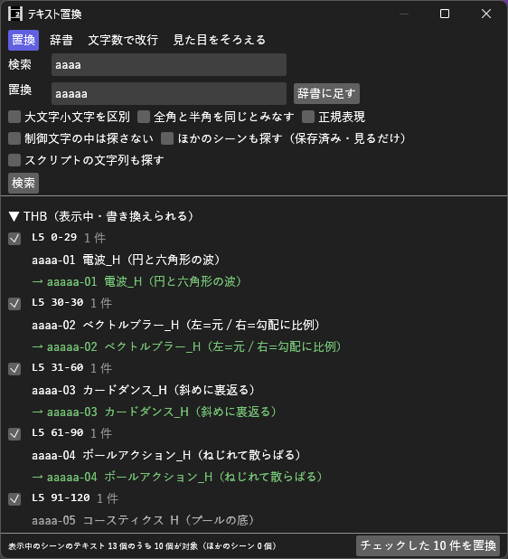

# TextReplace_H マニュアル



**TextReplace_H（テキスト置換）** は、テキストオブジェクトの本文を検索して、表示中のシーンの当たった箇所をまとめて置き換えるプラグイン（Rust 製 `.aux2`）です。指定した文字数で**改行**する、よく直す組を**辞書**にしてまとめて流す、テキストの**見た目（フォント・色など）をそろえる**こともできます。テロップの表記ゆれ（「ｳﾏ娘」と「ウマ娘」など）を直したり、長い字幕を決まった文字数で折り返したりするのに使います。

- **バージョン:** 0.2.1（2026-10-10: 開いても出てこなかった右クリックと編集メニューの「テキスト置換を開く」を外した。表示メニューから開きます。0.2.0 で辞書・スクリプトの文字列・見た目をそろえるを足した）
- **作者:** by HexBrowns
- **必要環境:** AviUtl2 **2.1.11** 以上

書き換えは、チェックした行を**ボタンでまとめて**書きます。1 回分は本体の **元に戻す（Ctrl+Z）1 回** で戻ります。制御文字（`<#色>` `<s32>` `<$プリセット>` など）は壊しません。

---

## 開き方

- **表示** メニュー → **テキスト置換**（ウィンドウ配置パネルからも選択可）

## 導入

1. [Releases](https://github.com/HexBrowns/TextReplace_H/releases) から `HexBrowns.TextReplace_H-v0.2.0.au2pkg.zip` をダウンロードし、AviUtl2 のプレビューへドラッグ&ドロップする
   （手で置くなら、中の `Plugin` フォルダをデータフォルダ `C:\ProgramData\aviutl2` へコピーする）
2. AviUtl2 を再起動する
3. **表示** メニュー → **テキスト置換** でウィンドウを開く

導入されるのは `Plugin\TextReplace_H\TextReplace_H.aux2` だけです。辞書を使うと、同じフォルダに `辞書.json` ができます。

### ビルド（開発者向け）

```bash
python AI/tools/au2_build.py TextReplace_H
```

---

## 使い方

### 置換

1. 上の **置換** を選ぶ
2. **検索** と **置換** に語を入れて **検索** を押す
3. 当たったテキストが一覧に出ます（`L3 120-239` の下に、元の本文と `→` の後の本文）。書き換えたくない行はチェックを外す
4. **チェックした N 件を置換** を押す

### 辞書

よく直す組（「ｳﾏ娘」→「ウマ娘」など）を辞書にしておき、まとめて流します。

1. 上の **辞書** を選ぶ
2. **組を足す** で行を足し、**検索** と **置換** に語を入れる。**使う** を外した組は流さない。**↑** **↓** で順番を変える
3. **辞書で検索** → 一覧を見て **チェックした N 件を置換**

- 組は **上から順に** 置き換えます。前の組で置き換えた結果に、後ろの組も当たります
- 検索のオプション（下の表）は全部の組に共通です
- **置換** の画面の **辞書に足す** で、いま入れている組を辞書に足せます
- 辞書は変えるとすぐ `Plugin\TextReplace_H\辞書.json` に保存されます

### 文字数で改行

1. 上の **文字数で改行** を選ぶ
2. **1 行の文字数** を決める。**絞り込み** に語を入れると、その語を含むテキストだけが対象（空ならすべて）
3. **検索** → 一覧を見て **チェックした N 件を改行**

| オプション | 内容 |
|------|------|
| 半角は 0.5 文字 | 英数字と半角カナを 0.5 文字として数える（既定オン） |
| 今の改行を残す | 今の改行の位置で数え直す（既定オン）。外すと、今の改行を消してから折り返す |
| 行頭禁則 | 句読点・閉じ括弧・小さい「っ」などで行を始めない（既定オン）。その行が 1 文字はみ出す |

### 検索のオプション（共通）

| オプション | 内容 |
|------|------|
| 大文字小文字を区別 | 既定オフ |
| 全角と半角を同じとみなす | 英数字・カタカナ（半角カナの濁点を含む）を同じとみなす。正規表現のときは使えない |
| 正規表現 | 置換語では `$1` などで当たった部分を使える |
| 制御文字の中は探さない | `<…>` の中は検索・置換しない（既定オン） |
| ほかのシーンも探す | 表示中でないシーンを、最後に保存した内容から探す（見るだけ。書き換えられない） |
| スクリプトの文字列も探す | テキスト系スクリプトの文字の項目（複数行の **テキスト** と 1 行の **文字列**）も対象にする（既定オフ）。一覧に効果名と項目名が出る |

### 見た目をそろえる

見本のテキストの見た目（フォント・色など）を、選んだテキストへ写します。本文は変えません。

1. 上の **見た目をそろえる** を選ぶ
2. 見本のテキストをクリックしてフォーカスし、**元を読む** を押す。テキストの項目が並ぶので、写す項目にチェックを付ける（最初はフォント・文字色・影・縁色・文字装飾）
3. 写したいテキストをタイムラインで選択し、**選択を読む** を押す
4. **選択中の N 個に M 項目を写す** を押す

- 1 回分は本体の **Ctrl+Z 1 回** で戻ります
- **選択を読む** の後に選択を変えると、何も書かずに止まります。もう一度 **選択を読む** を押してください
- 選択の中のテキスト以外のオブジェクトと、見本自身には書きません

### 一覧

- 見出しは **シーン名（表示中・書き換えられる）** と **シーン名（保存済み・見るだけ）**
- `L3 120-239`（レイヤーと範囲）をクリックすると、そのオブジェクトにフォーカスが移る（表示中のシーンだけ）
- 後の本文にマウスを乗せると、全文が出る（`⏎` は改行）

---

## 注意事項・制限

- 書き換えられるのは**表示中のシーン**だけです。ほかのシーンは、そのシーンを表示してから検索し直してください
- 検索した後に条件を変えると、書き込みのボタンが押せなくなります。もう一度 **検索** を押してください
- 書く直前に本文を読み直し、検索の後に本体側で変わっていたテキストは書かずに知らせます
- 対象は、効果名「テキスト」の本文です。**スクリプトの文字列も探す** をオンにすると、テキスト系のスクリプトの文字の項目も入ります
- 1 行の **文字列** の項目は、`\` を含む値と、置き換えた結果に `\` か改行が入るものを対象から外します（外した数は一覧の上に出ます）
